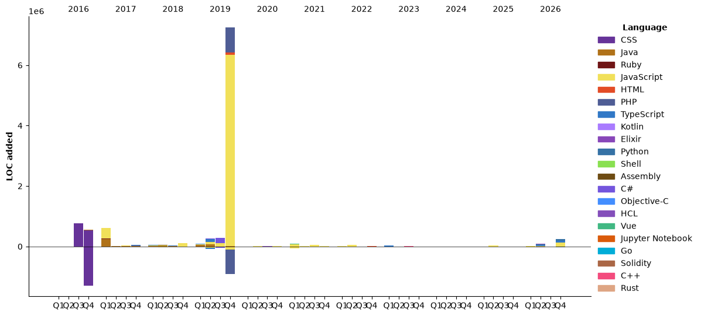

### Hello!, I'm Joshua Saucedo
*Cloud/DevOps/Software Engineer*  

[](https://www.linkedin.com/in/joshua-nathanael-saucedo-uriarte-bb0336169/)
[](https://www.codewars.com/users/joshuansu0897)

<!--START_SECTION:waka-->


**🐱 My GitHub Data** 

> 📦 240.8 kB Used in GitHub's Storage 
 > 
> 🏆 179 Contributions in the Year 2026
 > 
> 💼 Opted to Hire
 > 
> 📜 90 Public Repositories 
 > 
> 🔑 51 Private Repositories 
 > 
**I'm an Early 🐤** 

```text
🌞 Morning                1828 commits        ⣿⣿⣿⣿⣿⣿⣿⣀⣀⣀⣀⣀⣀⣀⣀⣀⣀⣀⣀⣀⣀⣀⣀⣀⣀   28.78 % 
🌆 Daytime                2727 commits        ⣿⣿⣿⣿⣿⣿⣿⣿⣿⣿⣿⣀⣀⣀⣀⣀⣀⣀⣀⣀⣀⣀⣀⣀⣀   42.94 % 
🌃 Evening                1669 commits        ⣿⣿⣿⣿⣿⣿⣿⣀⣀⣀⣀⣀⣀⣀⣀⣀⣀⣀⣀⣀⣀⣀⣀⣀⣀   26.28 % 
🌙 Night                  127 commits         ⣀⣀⣀⣀⣀⣀⣀⣀⣀⣀⣀⣀⣀⣀⣀⣀⣀⣀⣀⣀⣀⣀⣀⣀⣀   02.00 % 
```
📅 **I'm Most Productive on Tuesday** 

```text
Monday                   959 commits         ⣿⣿⣿⣿⣀⣀⣀⣀⣀⣀⣀⣀⣀⣀⣀⣀⣀⣀⣀⣀⣀⣀⣀⣀⣀   15.10 % 
Tuesday                  2134 commits        ⣿⣿⣿⣿⣿⣿⣿⣿⣀⣀⣀⣀⣀⣀⣀⣀⣀⣀⣀⣀⣀⣀⣀⣀⣀   33.60 % 
Wednesday                764 commits         ⣿⣿⣿⣀⣀⣀⣀⣀⣀⣀⣀⣀⣀⣀⣀⣀⣀⣀⣀⣀⣀⣀⣀⣀⣀   12.03 % 
Thursday                 1084 commits        ⣿⣿⣿⣿⣀⣀⣀⣀⣀⣀⣀⣀⣀⣀⣀⣀⣀⣀⣀⣀⣀⣀⣀⣀⣀   17.07 % 
Friday                   543 commits         ⣿⣿⣀⣀⣀⣀⣀⣀⣀⣀⣀⣀⣀⣀⣀⣀⣀⣀⣀⣀⣀⣀⣀⣀⣀   08.55 % 
Saturday                 485 commits         ⣿⣿⣀⣀⣀⣀⣀⣀⣀⣀⣀⣀⣀⣀⣀⣀⣀⣀⣀⣀⣀⣀⣀⣀⣀   07.64 % 
Sunday                   382 commits         ⣿⣿⣀⣀⣀⣀⣀⣀⣀⣀⣀⣀⣀⣀⣀⣀⣀⣀⣀⣀⣀⣀⣀⣀⣀   06.01 % 
```


📊 **This Week I Spent My Time On** 

```text
💬 Programming Languages: 
Rust                     5 hrs 28 mins       ⣿⣿⣿⣿⣿⣿⣿⣿⣿⣿⣀⣀⣀⣀⣀⣀⣀⣀⣀⣀⣀⣀⣀⣀⣀   40.44 % 
Markdown                 5 hrs 9 mins        ⣿⣿⣿⣿⣿⣿⣿⣿⣿⣿⣀⣀⣀⣀⣀⣀⣀⣀⣀⣀⣀⣀⣀⣀⣀   38.12 % 
TypeScript               1 hr 52 mins        ⣿⣿⣿⣀⣀⣀⣀⣀⣀⣀⣀⣀⣀⣀⣀⣀⣀⣀⣀⣀⣀⣀⣀⣀⣀   13.83 % 
JSON                     20 mins             ⣿⣀⣀⣀⣀⣀⣀⣀⣀⣀⣀⣀⣀⣀⣀⣀⣀⣀⣀⣀⣀⣀⣀⣀⣀   02.47 % 
Other                    14 mins             ⣀⣀⣀⣀⣀⣀⣀⣀⣀⣀⣀⣀⣀⣀⣀⣀⣀⣀⣀⣀⣀⣀⣀⣀⣀   01.76 % 

🔥 Editors: 
Claude Code              5 hrs 59 mins       ⣿⣿⣿⣿⣿⣿⣿⣿⣿⣿⣿⣀⣀⣀⣀⣀⣀⣀⣀⣀⣀⣀⣀⣀⣀   44.34 % 
VS Code                  5 hrs 50 mins       ⣿⣿⣿⣿⣿⣿⣿⣿⣿⣿⣿⣀⣀⣀⣀⣀⣀⣀⣀⣀⣀⣀⣀⣀⣀   43.22 % 
Obsidian                 1 hr 40 mins        ⣿⣿⣿⣀⣀⣀⣀⣀⣀⣀⣀⣀⣀⣀⣀⣀⣀⣀⣀⣀⣀⣀⣀⣀⣀   12.45 % 

💻 Operating System: 
Windows                  13 hrs 31 mins      ⣿⣿⣿⣿⣿⣿⣿⣿⣿⣿⣿⣿⣿⣿⣿⣿⣿⣿⣿⣿⣿⣿⣿⣿⣿   100.00 % 
```

🤖 **AI Coding This Week** 

```text
⏱ AI Coding Time: 6 hrs 1 min (44.59%)

✍️ 15,510 lines written by AI, 554 lines written by hand (96.55% AI-written)

🔤 2,131,225 Input Tokens, 924,460 Output Tokens

💵 $59.89 Estimated AI Cost This Week

🧠 6 AI Sessions, 69 AI Prompts

Opus                     15,711 lines        ⣿⣿⣿⣿⣿⣿⣿⣿⣿⣿⣿⣿⣿⣿⣿⣿⣿⣿⣿⣿⣿⣿⣿⣿⣿   100.00 % 

🔎 AI Coding Insights:
🤖 AI-Driven — 96.55% of written lines came from AI
📚 Verbose Prompter — average 1,825 characters per prompt
🔁 Iterative Prompter — average 12 prompts per session
🚀 High AI Trust — 3.83% of changed lines were hand-edited
```

**I Mostly Code in JavaScript** 

```text
JavaScript               41 repos            ⣿⣿⣿⣿⣿⣿⣿⣿⣀⣀⣀⣀⣀⣀⣀⣀⣀⣀⣀⣀⣀⣀⣀⣀⣀   30.15 % 
TypeScript               13 repos            ⣿⣿⣀⣀⣀⣀⣀⣀⣀⣀⣀⣀⣀⣀⣀⣀⣀⣀⣀⣀⣀⣀⣀⣀⣀   09.56 % 
Python                   12 repos            ⣿⣿⣀⣀⣀⣀⣀⣀⣀⣀⣀⣀⣀⣀⣀⣀⣀⣀⣀⣀⣀⣀⣀⣀⣀   08.82 % 
HCL                      9 repos             ⣿⣿⣀⣀⣀⣀⣀⣀⣀⣀⣀⣀⣀⣀⣀⣀⣀⣀⣀⣀⣀⣀⣀⣀⣀   06.62 % 
Rust                     2 repos             ⣀⣀⣀⣀⣀⣀⣀⣀⣀⣀⣀⣀⣀⣀⣀⣀⣀⣀⣀⣀⣀⣀⣀⣀⣀   01.47 % 
```


**Timeline**




 Last Updated on 07/11/2026 15:18:47 UTC
<!--END_SECTION:waka-->
